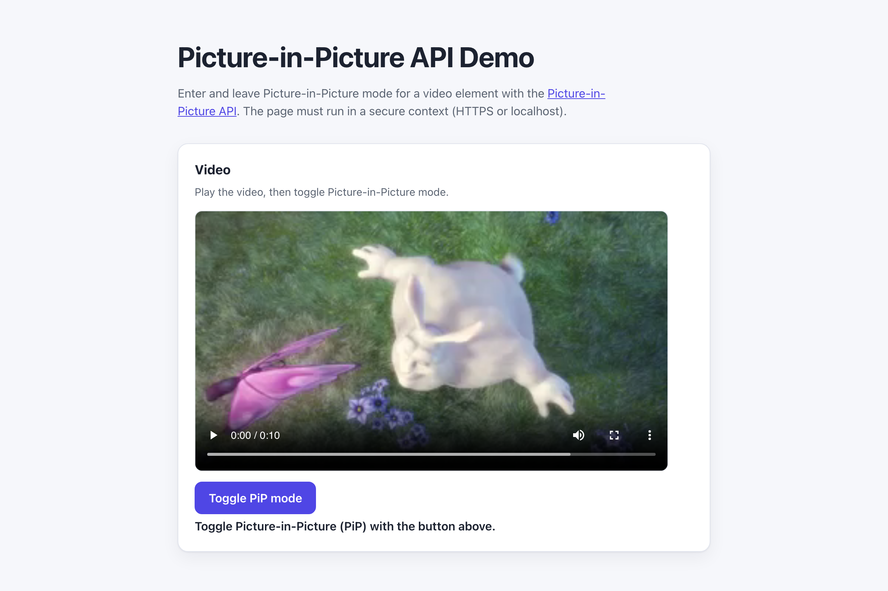

# WebSharper.PictureInPicture

[](https://github.com/dotnet-websharper/PictureInPictureAPI)

WebSharper bindings for the [Picture-in-Picture API](https://developer.mozilla.org/en-US/docs/Web/API/Picture-in-Picture_API) —
entering and leaving Picture-in-Picture mode for HTML video elements.

The Picture-in-Picture API is only available in [secure contexts](https://developer.mozilla.org/en-US/docs/Web/Security/Defenses/Secure_Contexts)
(HTTPS or localhost), and the user must trigger it with a gesture.

This repository contains:

| Project | Purpose |
| --- | --- |
| `WebSharper.PictureInPicture` | The binding: WIG definitions for `PictureInPictureWindow`, `PictureInPictureEvent`, and `PictureInPictureEventInit`. |
| `WebSharper.PictureInPicture.Extensions` | `[<Inline>]` client extensions: `requestPictureInPicture()`, `disablePictureInPicture`, and the enter/leave events on `HTMLVideoElement`. |
| `WebSharper.PictureInPicture.Sample` | An ASP.NET Core SPA that toggles Picture-in-Picture mode on a video element. |

## Live demos

**Try it live:** [Open the sample in your browser](https://dotnet-websharper.github.io/PictureInPictureAPI/)



The sample doubles as the binding's [test case](#running-the-sample): it enters and leaves Picture-in-Picture mode on a real video element in a real browser.

- **Sample (this repository):** <https://dotnet-websharper.github.io/PictureInPictureAPI/>
- **Source repository:** <https://github.com/dotnet-websharper/PictureInPictureAPI>
- **WebSharper bindings:** <https://websharper.com/bindings>

## Features

- `PictureInPictureWindow` (`width`, `height`, `onresize`).
- `PictureInPictureEvent` (`pictureInPictureWindow`) and `PictureInPictureEventInit`.
- `HTMLVideoElement.requestPictureInPicture()` and `disablePictureInPicture`.
- `HTMLVideoElement.onenterpictureinpicture` and `onleavepictureinpicture`.
- `document.pictureInPictureElement` and `document.exitPictureInPicture()` from the core `Document` type.

## Installation

The binding is not currently published to NuGet. Reference the projects from source:

```bash
git clone https://github.com/dotnet-websharper/PictureInPictureAPI.git
```

```xml
<ItemGroup>
  <ProjectReference Include="path/to/WebSharper.PictureInPicture/WebSharper.PictureInPicture.fsproj" />
  <ProjectReference Include="path/to/WebSharper.PictureInPicture.Extensions/WebSharper.PictureInPicture.Extensions.fsproj" />
</ItemGroup>
```

## Usage

```fsharp
namespace WebSharper.PictureInPicture.Demo

open WebSharper
open WebSharper.JavaScript
open WebSharper.PictureInPicture

[<JavaScript>]
module Demo =
    let togglePiP (video: HTMLVideoElement) =
        promise {
            let doc = JS.Document
            if Optional.isUndefined doc.PictureInPictureElement then
                let! _ = video.RequestPictureInPicture()
                ()
            else
                do! doc.ExitPictureInPicture()
        }
```

The `requestPictureInPicture()` and `disablePictureInPicture` members are declared in the Extensions assembly and hang off
`HTMLVideoElement`. `PictureInPictureWindow` is a `Dom.EventTarget` with `width`, `height`, and an `onresize` event.

## Running the sample

Build the sample in Release and serve its static output:

```bash
dotnet build WebSharper.PictureInPicture.Sample/WebSharper.PictureInPicture.Sample.fsproj -c Release
python3 -m http.server -d WebSharper.PictureInPicture.Sample/wwwroot 8202
```

Open <http://localhost:8202/>. Localhost counts as a secure context, so the Picture-in-Picture API is available.

Alternatively, run the ASP.NET Core host:

```bash
dotnet run --project WebSharper.PictureInPicture.Sample
```

## Building from source

### Prerequisites

- [.NET SDK 10](https://dotnet.microsoft.com/download) or later.

### Build

```bash
dotnet build WebSharper.PictureInPicture.sln -c Release
```

The binding projects target `netstandard2.0`; the sample targets `net10.0`.

## Deployment

Pushing to `main` triggers `.github/workflows/ghpages.yml`, which builds the sample in Release and publishes
`WebSharper.PictureInPicture.Sample/wwwroot` to the `gh-pages` branch.

## Repository layout

```
WebSharper.PictureInPicture/              # binding (WIG definitions)
  Main.fs
WebSharper.PictureInPicture.Extensions/   # [<Inline>] client extensions
  Library.fs
WebSharper.PictureInPicture.Sample/       # ASP.NET Core SPA demo
  Client.fs
  Startup.fs
  wwwroot/
    index.html
    site.css
.github/workflows/ghpages.yml             # build + deploy the sample to GitHub Pages
```

## Notes on the API

- **Secure context:** the Picture-in-Picture API is only exposed in secure contexts. Serve the page over HTTPS or
  from localhost.
- **User gesture:** the request must come from a user gesture (for example, a button click).
- **One window:** only one video element can be in PiP mode at a time.
- **Browser support:** support varies by browser. Check the MDN compatibility table before relying on it.
- **Video source:** the sample uses a public MP4 sample. Replace it with your own video for production.

## License

Apache 2.0 — see [LICENSE.md](LICENSE.md).
